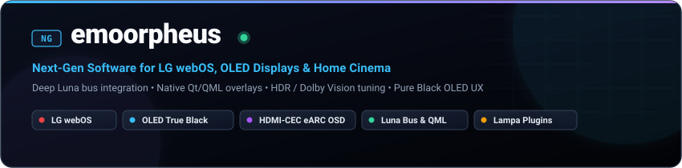

<div align="center">
  

  <br/><br/>

  <p align="center">
    <a href="https://github.com/emoorpheus?tab=repositories"></a>
    <a href="https://github.com/emoorpheus"></a>
    <a href="https://github.com/emoorpheus/eArcNG"></a>
    <a href="https://github.com/emoorpheus"></a>
  </p>
</div>

### ⚡ Overview

Software engineer, IT infrastructure lead, and home cinema enthusiast focused on **embedded Smart TV platforms**, **OLED display optimization**, and **frictionless media streaming**.

My primary focus is extending **LG webOS** beyond its factory limits:
- 🔌 **Deep System Integration:** Interfacing directly with low-level `Luna-Send` bus services, IPC daemons, and system audio/display pipelines.
- 🖤 **OLED-First Design:** Engineering pure-black (`#000000`) interfaces, sub-pixel contrast tuning, and glare-free HDR / Dolby Vision subtitle renderers.
- 🚀 **Next-Gen (NG) Applications:** Rebuilding sluggish native web apps into responsive, ad-free, high-performance TV experiences.

---

### 🚀 The Next-Gen (NG) webOS Suite

| Project | Description | Stack | Highlights |
|:---|:---|:---|:---|
| [**HearthNG**](https://github.com/emoorpheus/HearthNG) | **OLED-First Lightweight Custom Launcher for LG webOS**<br/>Fast cold boot, custom true black theme, app hide/reorder, smooth animations &amp; native system toast indicators. | `TypeScript`<br/>`Svelte`<br/>`Luna Bus` | [](https://github.com/emoorpheus/HearthNG/releases) |
| [**eArcNG**](https://github.com/emoorpheus/eArcNG) | **Native HDMI-CEC eARC/ARC Soundbar Volume OSD**<br/>Seamless on-screen volume &amp; mute indicator for external audio systems using private Luna audio bus subscriptions (`com.webos.service.audio`). | `Python`<br/>`Qt / QML`<br/>`Luna Service` | [](https://github.com/emoorpheus/eArcNG) |
| [**YoutubeNG**](https://github.com/emoorpheus/YoutubeNG) | **Next-Gen YouTube Client for webOS**<br/>Ad-free viewing, SponsorBlock, Return YouTube Dislike (RYD), 0.25x–3x custom playback speeds, and pure black OLED dark mode. | `JavaScript`<br/>`webOS Cobalt`<br/>`SponsorBlock` | [](https://github.com/emoorpheus/YoutubeNG) |
| [**TwitchNG**](https://github.com/emoorpheus/TwitchNG) | **Custom Twitch Client for webOS**<br/>High-performance Twitch app with pitch-preserving VOD playback speed controls and an OLED-optimized dark theme. | `JavaScript`<br/>`webOS`<br/>`HLS.js` | [](https://github.com/emoorpheus/TwitchNG) |

---

### 🎬 Home Cinema &amp; Media Streaming Plugins

| Project | Description | Stack | Highlights |
|:---|:---|:---|:---|
| [**lampa-adaptive-subtitles**](https://github.com/emoorpheus/lampa-adaptive-subtitles) | **Anti-Glare Adaptive Subtitles for HDR / Dolby Vision**<br/>Intelligent subtitle luminance control preventing blinding white text glare on high-nit OLED panels while keeping subtitles sharp and readable. | `JavaScript`<br/>`CSS`<br/>`Canvas DOM` | [](https://github.com/emoorpheus/lampa-adaptive-subtitles) |
| [**lampa-skip-intro**](https://github.com/emoorpheus/lampa-skip-intro) | **Automated Intro &amp; Recap Skipper for Lampa**<br/>Smart multi-source timestamp aggregator (KinoPoisk, Anilibria, TVMaze) for zero-click intro and credits skipping. | `JavaScript`<br/>`Lampa Plugin API` | [](https://github.com/emoorpheus/lampa-skip-intro) |

---

### 🛠 Tech Stack &amp; Architecture

```
┌─────────────────┬─────────────────────────────────────────────────────────────────────────┐
│ Category        │ Technologies & Tools                                                    │
├─────────────────┼─────────────────────────────────────────────────────────────────────────┤
│ TV & Embedded   │ LG webOS 24/25, Luna Bus (luna-send / luna-service2), WebOSBrew, Linux  │
│ Languages       │ TypeScript, JavaScript (ESNext), Python 3, Qt/QML, Shell / Bash         │
│ Frontend & UI   │ Svelte, Tailwind CSS, Pure Black (#000000), Custom WebProcess Injection │
│ Audio & Video   │ HDMI-CEC eARC, Dolby Vision, HDR10, HLG, Subtitle Pipeline Tuning       │
│ Infrastructure  │ OpenWrt, Armbian HomeLab, WireGuard, Reverse Proxies, Docker            │
└─────────────────┴─────────────────────────────────────────────────────────────────────────┘
```

---

### 📊 GitHub Activity &amp; Streak

<div align="center">
  <a href="https://github.com/emoorpheus">
    
  </a>
  <br/><br/>
  <a href="https://github.com/emoorpheus">
    
  </a>
</div>

---

<div align="center">
  <sub>Engineered with precision for true black OLED displays &amp; uncompromised media playback.</sub>
</div>
